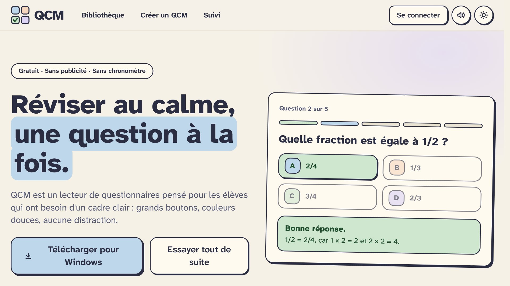
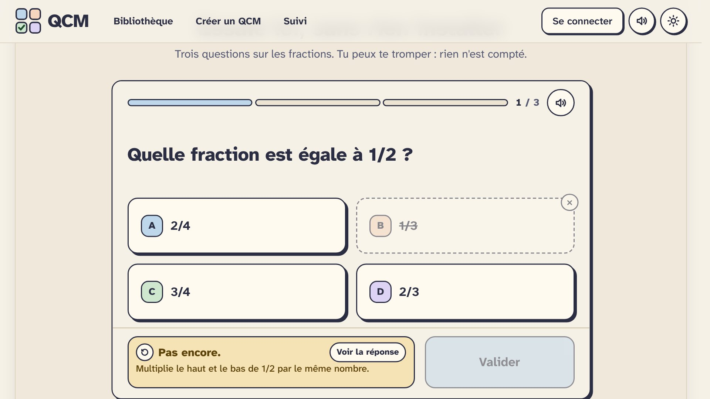
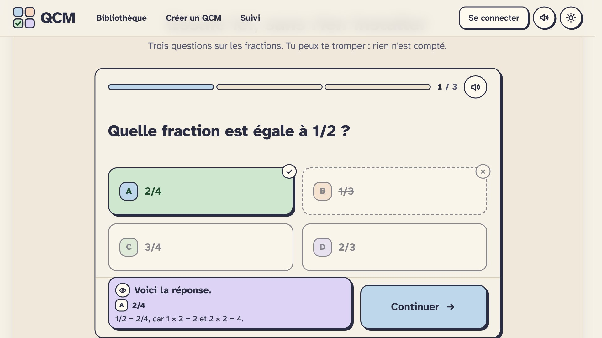
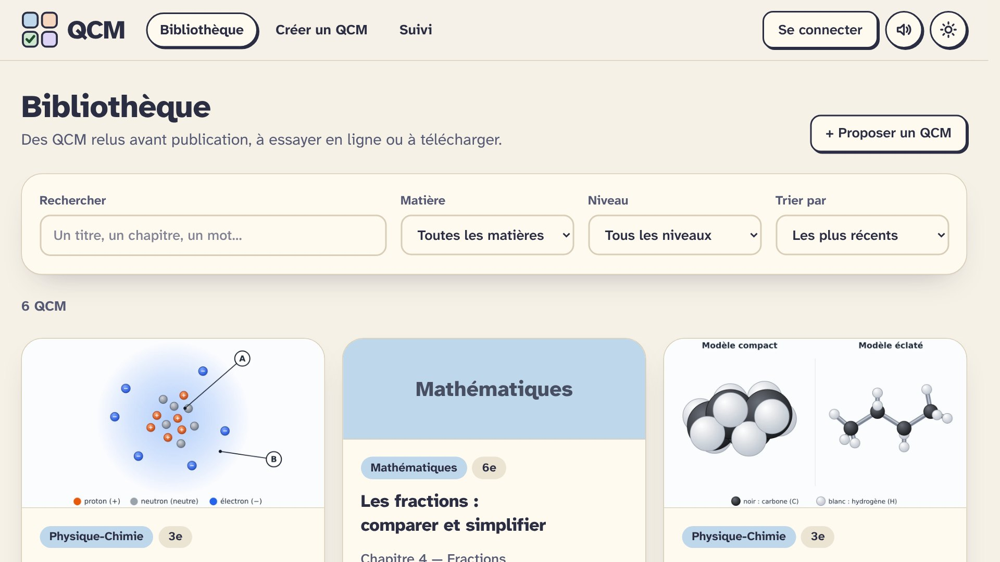
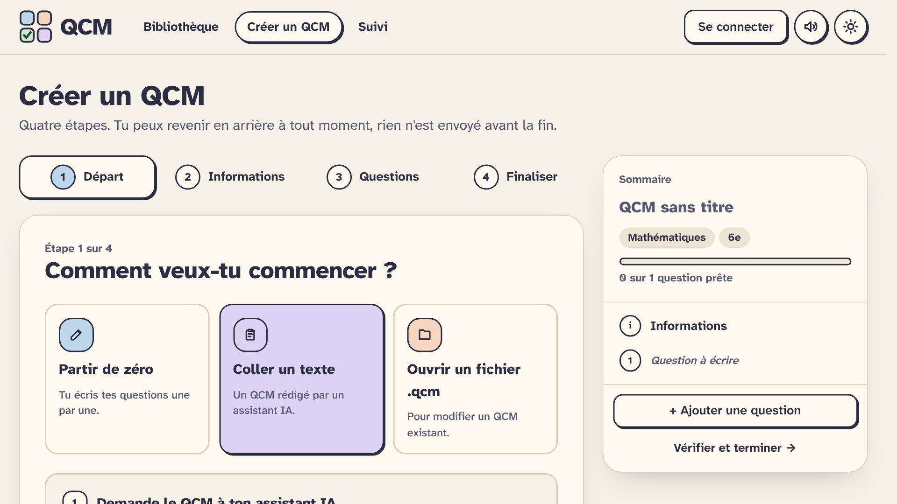
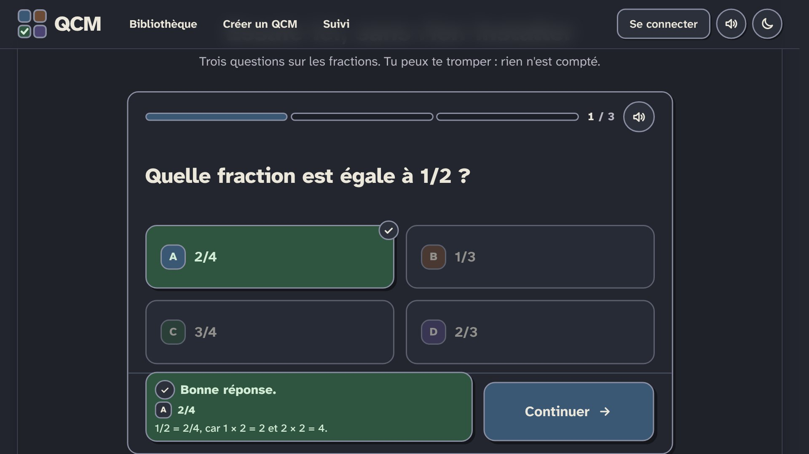
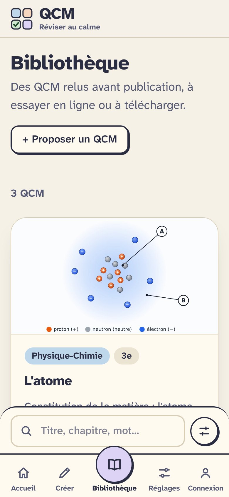

<p align="center">
  
</p>

<h1 align="center">QCM</h1>

<p align="center">
  <strong>Réviser au calme, une question à la fois.</strong><br />
  Des questionnaires sans publicité, sans chronomètre et sans score, pour les élèves qui veulent travailler leur cours.
</p>

<p align="center">
  <a href="https://qcm.aifedespaix.com">Site</a> ·
  <a href="https://qcm.aifedespaix.com/bibliotheque">Bibliothèque</a> ·
  <a href="https://github.com/aifedespaix/QCM/releases/latest">Lecteur Windows</a> ·
  <a href="ARCHITECTURE.md">Architecture</a> ·
  <a href="TASKS.md">Ce qui reste à faire</a>
</p>

<p align="center">
  
  
  
  
  
  
</p>

<p align="center">
  
</p>

---

## Sommaire

- [Pourquoi QCM](#pourquoi-qcm)
- [Aperçu](#aperçu)
- [Fonctionnalités](#fonctionnalités)
- [Le format `.qcm`](#le-format-qcm)
- [Architecture](#architecture)
- [Démarrer en local](#démarrer-en-local)
- [Déploiement](#déploiement)
- [Publier des QCM avec un agent IA](#publier-des-qcm-avec-un-agent-ia)
- [Tests et qualité](#tests-et-qualité)
- [Documentation](#documentation)

## Pourquoi QCM

Beaucoup d'applications de quiz sont pensées pour jouer : points, séries, classements, minuteurs, confettis. QCM fait l'inverse. Il sert à **réviser un cours** dans un cadre clair et prévisible : une seule question à l'écran, de grands boutons, des couleurs douces, et une explication courte après chaque réponse.

Quelques choix qui en découlent :

- **Aucun score pendant la révision.** Pas de chronomètre, de note, de série ni de classement. L'écran de fin ne juge pas.
- **Se tromper n'est pas grave.** Une erreur n'est jamais rouge : la réponse essayée est grisée, un indice peut s'afficher, et l'élève peut réessayer ou voir la réponse.
- **Choisir, puis valider.** Cette étape en plus évite de répondre trop vite.
- **Prévisible.** Chaque QCM annonce son titre, sa matière, son chapitre et son nombre de questions avant de commencer.
- **Hors-ligne et sans compte.** Le lecteur Windows fonctionne sans Internet, et rien n'oblige à se connecter pour réviser.

## Aperçu

<table>
  <tr>
    <td width="50%"></td>
    <td width="50%"></td>
  </tr>
  <tr>
    <td align="center"><sub>Après une mauvaise réponse : un indice, sans rouge.</sub></td>
    <td align="center"><sub>La bonne réponse et son explication.</sub></td>
  </tr>
  <tr>
    <td></td>
    <td></td>
  </tr>
  <tr>
    <td align="center"><sub>La bibliothèque : recherche, matière, niveau, tri.</sub></td>
    <td align="center"><sub>L'éditeur en quatre étapes.</sub></td>
  </tr>
  <tr>
    <td></td>
    <td align="center"></td>
  </tr>
  <tr>
    <td align="center"><sub>Thème sombre.</sub></td>
    <td align="center"><sub>Sur téléphone.</sub></td>
  </tr>
</table>

## Fonctionnalités

### Le lecteur

- Une question à la fois, avec progression visible et images agrandissables en plein écran (zoom).
- Réponse unique ou multiple, au clic, au toucher ou au clavier : `1` à `4` ou `A` à `D` pour choisir, `Entrée` ou `Espace` pour l'action principale.
- Indice facultatif, explication après chaque question, bouton « Voir la réponse ».
- Thèmes clair et sombre, sons que l'on coupe d'un bouton, animations courtes qui respectent `prefers-reduced-motion`.
- Police Atkinson Hyperlegible, embarquée : aucune requête vers un CDN.

### Le suivi des révisions

Un écran séparé, destiné aux parents : ce qui est acquis, ce qui mérite d'être revu, sur 7 jours, 30 jours ou depuis le début. Les résultats restent **sur l'appareil** (`localStorage`) : rien n'est envoyé sur Internet, et l'élève ne voit jamais de score pendant qu'il révise.

### Le lecteur Windows (Tauri 2)

- Un double-clic sur un fichier `.qcm` l'ouvre dans le lecteur (association de fichier).
- Installateur par utilisateur : **aucun droit administrateur** nécessaire. `.exe` (NSIS) et `.msi`.
- Mise à jour en un clic, jamais pendant un QCM et jamais imposée. Hors-ligne, la vérification échoue en silence.
- Les QCM déjà ouverts sont conservés sur l'ordinateur, et la bibliothèque en ligne reste consultable depuis le lecteur.

### Le site et la bibliothèque

- Bibliothèque de QCM relus avant publication : recherche, filtres par matière et niveau, tri, notes et commentaires.
- Essai en ligne sans rien installer, ou téléchargement du fichier `.qcm`.
- Connexion avec Google, uniquement pour proposer un QCM, noter ou commenter.
- Application web installable (PWA), avec une page de secours hors-ligne.
- Modération : un QCM proposé passe par une validation avant d'être public, et un administrateur peut masquer un QCM ou un commentaire sans le supprimer.

### L'éditeur en ligne

Un parcours guidé en quatre étapes (départ, informations, questions, finalisation), avec un sommaire toujours visible. On peut :

- écrire ses questions une par une ;
- ouvrir un fichier `.qcm` existant pour le modifier ;
- coller un QCM rédigé par un assistant IA (le prompt à copier est fourni) ;
- exporter un fichier `.qcm` ou le proposer à la bibliothèque.

## Le format `.qcm`

Un `.qcm` est une archive ZIP qui contient un fichier `data.yaml` et, si besoin, un dossier `media/` d'images WebP. Il se partage comme n'importe quel fichier et se valide avec le même schéma (Zod) partout : lecteur, site et éditeur.

```yaml
version: 1
meta:
  title: "Les fractions : comparer et simplifier"
  subject: maths
  level: 6e
  chapter: "Chapitre 4 — Fractions"
  language: fr
  author: "Équipe QCM"
  description: "Cinq questions pour revoir les fractions égales et la simplification."
questions:
  - id: q1
    prompt: "Quelle fraction est égale à 1/2 ?"
    choices:
      - text: "2/4"
        correct: true
      - text: "1/3"
      - text: "3/4"
      - text: "2/3"
    hint: "Multiplie le haut et le bas de 1/2 par le même nombre."
    explanation: "1/2 = 2/4, car 1 × 2 = 2 et 2 × 2 = 4."
```

Pour illustrer une question, on ajoute `image: media/<nom>.webp`. Le dossier [`examples/`](examples) contient des QCM complets, avec schémas, pour la physique-chimie et la musique. Pour fabriquer ou vérifier un fichier :

```bash
bun run pack examples/fractions
```

Les règles pédagogiques (vocabulaire, longueur des réponses, ordre, indices) sont décrites dans [`docs/skill-ingestion-cours.md`](docs/skill-ingestion-cours.md).

## Architecture

Monorepo Bun. Le lecteur est écrit une seule fois et partagé par le site et le logiciel Windows.

```text
qcm/
├── packages/
│   ├── core/        @qcm/core : format .qcm (schéma Zod, archive ZIP, conversion WebP, suivi)
│   └── ui/          @qcm/ui   : lecteur, composants, thème, sons (Vue 3 + Tailwind CSS 4)
├── apps/
│   ├── desktop/     lecteur Windows (Tauri 2, Rust + Vue 3)
│   └── web/         site, bibliothèque et éditeur (Astro statique + îlots Vue)
├── backend/         PocketBase : collections, règles d'accès, hooks, migrations
├── examples/        QCM d'exemple prêts à publier
└── docs/            guides (rédaction de QCM, publication par un agent)
```

| Brique | Choix | Pourquoi |
|---|---|---|
| Interface | Vue 3, Tailwind CSS 4 | Un seul lecteur, partagé par le web et le desktop |
| Site | Astro en mode statique | Rien à héberger côté serveur : nginx suffit, les îlots Vue parlent à PocketBase depuis le navigateur |
| Desktop | Tauri 2 | Petit installateur, démarrage rapide, association des fichiers `.qcm` |
| Validation | Zod, côté webview | Un seul schéma pour le lecteur, le site et l'éditeur. Rust se contente de dézipper |
| Backend | PocketBase | Comptes, collections, règles d'accès et fichiers dans un seul binaire |
| Hébergement | Docker Compose sur Dokploy | `qcm-web` (nginx) et `qcm-pocketbase` sous le même domaine |

Les décisions, les contrats d'API des composants et les règles d'interface sont dans [`ARCHITECTURE.md`](ARCHITECTURE.md).

## Démarrer en local

Prérequis : [Bun](https://bun.sh) 1.4 ou plus. Pour le lecteur Windows : Rust et les [prérequis Tauri](https://tauri.app/start/prerequisites/).

```bash
git clone https://github.com/aifedespaix/QCM.git
cd QCM
bun install
```

Construire et lancer PocketBase en local (Docker), puis le site :

```bash
docker build -t qcm-pocketbase ./backend
docker run -d --name qcm-pb -p 8090:8090 \
  -e PB_SUPERUSER_EMAIL=admin@qcm.local \
  -e PB_SUPERUSER_PASSWORD=motdepasse-test-1234 \
  -e PB_ENCRYPTION_KEY=0123456789abcdef0123456789abcdef \
  qcm-pocketbase

PUBLIC_PB_URL=http://127.0.0.1:8090 bun run dev:web   # http://localhost:4321
```

Lancer le lecteur Windows en développement :

```bash
bun run dev:desktop
```

Publier le QCM d'exemple dans cette base :

```bash
PB_URL=http://127.0.0.1:8090 PB_SUPERUSER_EMAIL=admin@qcm.local PB_SUPERUSER_PASSWORD=motdepasse-test-1234 \
  bun run --filter @qcm/web seed
```

### Variables d'environnement

Pour un déploiement, le fichier [`backend/.env.example`](backend/.env.example) liste les variables à fournir.

| Variable | Rôle |
|---|---|
| `PUBLIC_PB_URL` | Adresse publique de PocketBase (vide : même domaine que le site) |
| `PUBLIC_SITE_URL` | Adresse publique du site |
| `PUBLIC_RELEASES_URL` | Page des Releases GitHub, pour le bouton de téléchargement |
| `PB_SUPERUSER_EMAIL`, `PB_SUPERUSER_PASSWORD` | Compte administrateur PocketBase |
| `PB_ENCRYPTION_KEY` | 32 caractères aléatoires, chiffre les réglages en base |
| `PB_ALLOWED_ORIGINS` | Origines autorisées (CORS) |
| `GOOGLE_CLIENT_ID`, `GOOGLE_CLIENT_SECRET` | Connexion Google (facultative) |

## Déploiement

- **Site et PocketBase** : `docker-compose.yml` décrit deux services (`qcm-web`, `qcm-pocketbase`), prévus pour un déploiement Dokploy de type « Compose ». nginx sert le site statique et relaie `/api` vers PocketBase, ce qui évite tout souci de CORS. Les lectures de l'API sont rejouées automatiquement si une connexion traîne.
- **Lecteur Windows** : chaque push sur `main` construit les installateurs `.exe` et `.msi` sur GitHub Actions et publie une Release, avec le manifeste de mise à jour. Le numéro de version est calculé automatiquement. Voir [`.github/workflows/release-desktop.yml`](.github/workflows/release-desktop.yml).

## Publier des QCM avec un agent IA

Un membre crée un jeton révocable sur la page `/agent` du site et le donne à un agent avec l'adresse du site. L'agent publie ensuite des QCM à son nom, sans jamais connaître ni le compte Google ni un mot de passe. Les QCM d'un membre ordinaire passent par la relecture. La procédure complète (images, validation, erreurs) est dans [`docs/agent-publication.md`](docs/agent-publication.md).

```bash
QCM_SITE_URL=https://qcm.example.org QCM_AGENT_TOKEN=qcm_… \
  bun run --filter @qcm/web publish-qcm examples/fractions
```

## Tests et qualité

```bash
bun test              # @qcm/core, @qcm/ui, @qcm/web (lecture réseau)
bun run typecheck     # tsc, vue-tsc, astro check
bun run build:web     # build statique du site
```

Côté Rust : `cargo test` et `cargo clippy --all-targets -- -D warnings` depuis `apps/desktop/src-tauri`.

## Documentation

| Document | Contenu |
|---|---|
| [`ARCHITECTURE.md`](ARCHITECTURE.md) | Décisions, contrats des composants et des commandes Tauri, modèle de données, déploiement |
| [`TASKS.md`](TASKS.md) | Ce qui reste à valider ou à faire |
| [`docs/skill-ingestion-cours.md`](docs/skill-ingestion-cours.md) | Transformer un cours en QCM : format et règles pédagogiques |
| [`docs/agent-publication.md`](docs/agent-publication.md) | Publier avec un agent IA |

---

<p align="center">
  Projet présenté sur <a href="https://aifedespaix.com/projets/qcm/">aifedespaix.com</a>
</p>
